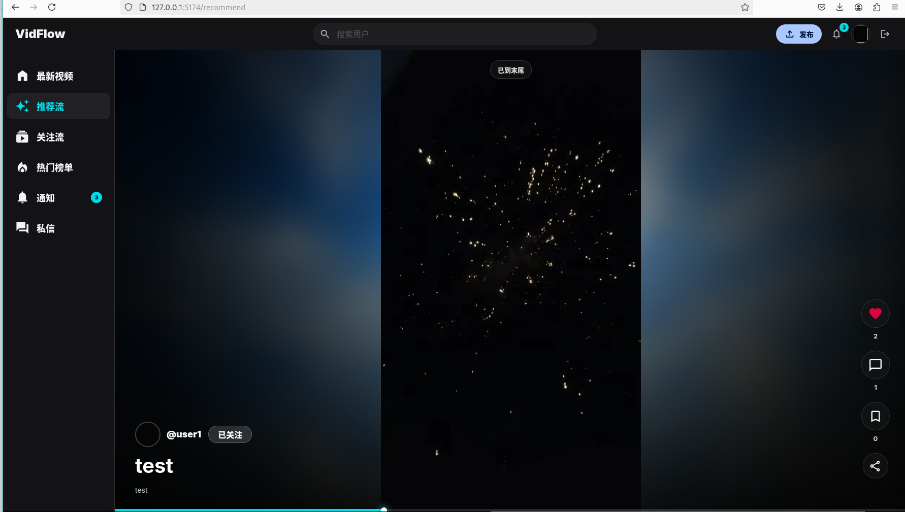

# VidFlow

VidFlow 是一个短视频 Feed 与即时通讯融合的内容社交系统。项目覆盖账号、视频发布、Feed 分发、推荐、互动、关系链、通知、IM、审核扩展、监控和容器化部署。



> 项目定位为开源 Feed 系统二次开发，上游参考项目：`https://github.com/LeoninCS/GCFeed`。

## 核心能力

### 内容与 Feed

- Timeline、Hot、Following、Recommend 多场景 Feed
- 游标分页、页缓存、卡片缓存、计数缓存和 singleflight 回源保护
- 视频发布、上传、详情、作者作品和软删除
- 推荐候选召回、相似度排序、新鲜度、热度和作者打散
- 曝光记录和近期曝光去重

### 社交互动

- 点赞、收藏、评论、关注和粉丝关系
- 互动计数分片、幂等写入和异步落库
- Redis Lua 原子更新互动状态、幂等键和计数
- 互动事件生成通知中心消息

### 即时通讯

- 单聊和基础群聊
- 会话列表、历史消息和 `sequence` 排序
- 客户端消息 ID 幂等
- 未读数和已读游标
- WebSocket 实时推送和断线重连
- Redis 在线状态
- 从用户主页发起私信
- 通过账号或昵称搜索并选择群成员

### 消息可靠性

- MySQL 事务 Outbox
- Outbox Dispatcher 与指数退避
- RabbitMQ Publisher Confirm
- 消费重试队列和死信队列
- 事件级幂等和最终一致性

### 可观测性与交付

- Prometheus 指标
- Grafana 面板
- Docker Compose 全栈编排
- 后端流程测试、仓储集成测试和前端生产构建

## 技术栈

| 层次 | 技术 |
| --- | --- |
| 后端 | Go、Gin、GORM |
| 实时通信 | WebSocket、Redis Presence |
| 数据存储 | MySQL、Redis |
| 消息队列 | RabbitMQ |
| 鉴权 | JWT |
| 前端 | React、Vite |
| 监控 | Prometheus、Grafana |
| 本地与部署 | Docker Compose、Nginx |

## 系统结构

```text
React Web
   |
   +--> REST API (/api/*)
   +--> WebSocket (/api/im/ws)
          |
          v
      Go API Monolith
          |
          +--> Account / Video / Feed / Recommendation
          +--> Interaction / Relation / Notification
          +--> IM Conversation / Message / Presence
          |
          +--> MySQL: 业务事实
          +--> Redis: 缓存、计数、在线状态、Lua 脚本
          +--> RabbitMQ: Fanout、异步落库、可靠事件
          |
          v
       Go Worker
          |
          +--> Interaction Worker
          +--> Feed Fanout Worker
          +--> Embedding Worker
          +--> Outbox Dispatcher
```

## 目录结构

```text
apps/
  api/
    cmd/feed/                  API 进程
    cmd/worker/                异步 Worker 进程
    configs/                   YAML 配置
    internal/
      domain/                  领域实体、错误和仓储接口
      application/             用例编排
      infra/                   MySQL、Redis、RabbitMQ、JWT、WebSocket
      interfaces/http/         Handler、DTO、中间件和路由
    test/                      后端流程测试
  web/
    src/                       React 客户端
  monitoring/                  Prometheus、Grafana 配置
  docker-compose.yml           全栈编排
```

## 快速启动

### Docker Compose

```bash
cd apps
docker compose up -d --build
```

服务地址：

| 服务 | 地址 |
| --- | --- |
| Web | `http://127.0.0.1:5173` |
| API | `http://127.0.0.1:8080` |
| API 健康检查 | `http://127.0.0.1:8080/health` |
| API 指标 | `http://127.0.0.1:8080/metrics` |
| MySQL | `127.0.0.1:3307` |
| Redis | `127.0.0.1:6379` |
| RabbitMQ 管理台 | `http://127.0.0.1:15672` |
| Prometheus | `http://127.0.0.1:9090` |
| Grafana | `http://127.0.0.1:3000` |

Grafana 默认账号：

```text
admin / admin
```

### 本地开发

先启动 MySQL、Redis 和 RabbitMQ，再运行：

```bash
./scripts/start.sh
```

也可以分别启动：

```bash
cd apps/api
go run ./cmd/feed
```

```bash
cd apps/api
go run ./cmd/worker
```

```bash
cd apps/web
npm ci
npm run dev
```

## IM 接口

### 会话与消息

| 方法 | 路径 | 作用 |
| --- | --- | --- |
| `POST` | `/api/conversations` | 创建或复用单聊，创建群聊 |
| `GET` | `/api/conversations` | 查询当前用户会话列表 |
| `GET` | `/api/conversations/:id/messages` | 查询历史消息 |
| `POST` | `/api/conversations/:id/messages` | 发送文本或视频卡片消息 |
| `PATCH` | `/api/conversations/:id/read` | 更新已读游标 |

### WebSocket

```text
GET /api/im/ws?token=<access_token>
```

服务端推送格式：

```json
{
  "type": "message.created",
  "data": {
    "id": 1,
    "conversation_id": 1,
    "sender_id": 1,
    "type": "TEXT",
    "content": "hello",
    "sequence": 1,
    "created_at": "2026-10-11T08:00:00Z"
  }
}
```

## 通知与私信

项目把系统通知和用户聊天分成两条独立链路：

```text
通知中心 /messages
  点赞、评论、关注、审核结果、系统公告

私信 /chat
  用户主动发起的单聊和群聊
```

通知数据保存在 `user_message`，聊天数据保存在 `im_conversation`、`im_conversation_member` 和 `im_message`。

## 用户搜索

```text
GET /api/users/search?q=<keyword>&limit=10
```

支持按账号或昵称模糊搜索，登录状态下默认排除当前用户。搜索结果返回账号名、昵称、头像和简介，用于用户主页跳转和群聊成员选择。

## 测试

### 后端

```bash
cd apps/api
go test ./...
go vet ./...
```

### 前端

```bash
cd apps/web
npm ci
npm run build
```

### MySQL 仓储集成测试

```bash
cd apps/api
IM_TEST_MYSQL_DSN='root:password@tcp(127.0.0.1:3307)/GCFeed?parseTime=true&charset=utf8mb4' \
go test ./internal/infra/persistence/im -run TestConversationFlowIntegration -count=1
```

### Compose 配置校验

```bash
cd apps
docker compose config
```

## 配置

主要配置文件：

```text
apps/api/configs/config.yaml
apps/api/configs/config.docker.yaml
```

配置覆盖：

- HTTP 端口
- JWT 密钥与有效期
- MySQL
- Redis
- RabbitMQ Exchange、Queue 和 Routing Key
- 内部服务 Token

生产环境不要沿用示例密码、JWT 密钥和内部 Token。

## 当前边界

- 项目是内容社区和 IM 的工程化实现，不等同于完整抖音或小红书。
- IM 当前覆盖单聊、基础群聊和在线实时推送，暂未实现音视频通话、消息撤回和复杂群权限。
- 推荐系统使用可解释规则和本地 hash n-gram 向量，暂未接入大规模特征平台。
- 审核后台、运营后台和系统治理仍有继续扩展空间。

## 上游说明

本项目基于 `https://github.com/LeoninCS/GCFeed` 进行二次开发。上游仓库当前未包含独立许可证文件，公开分发或商业使用前应先向上游作者确认授权。
